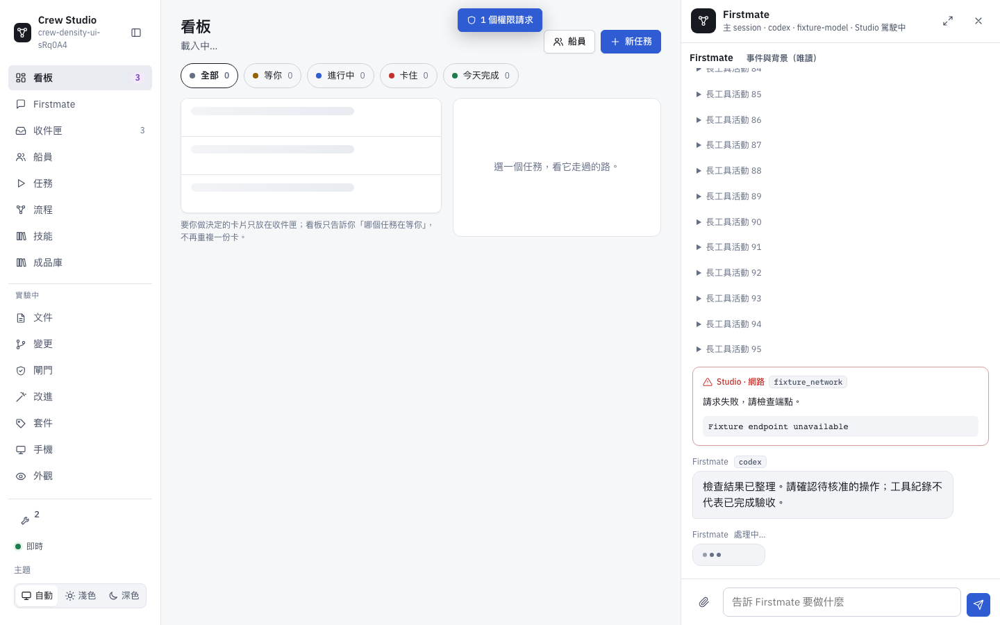
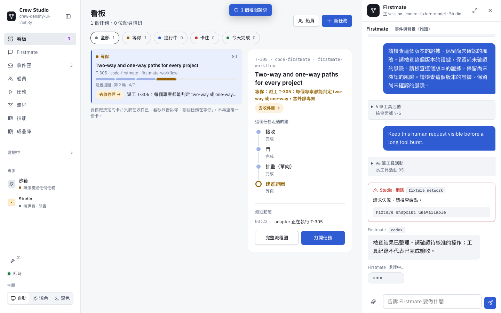
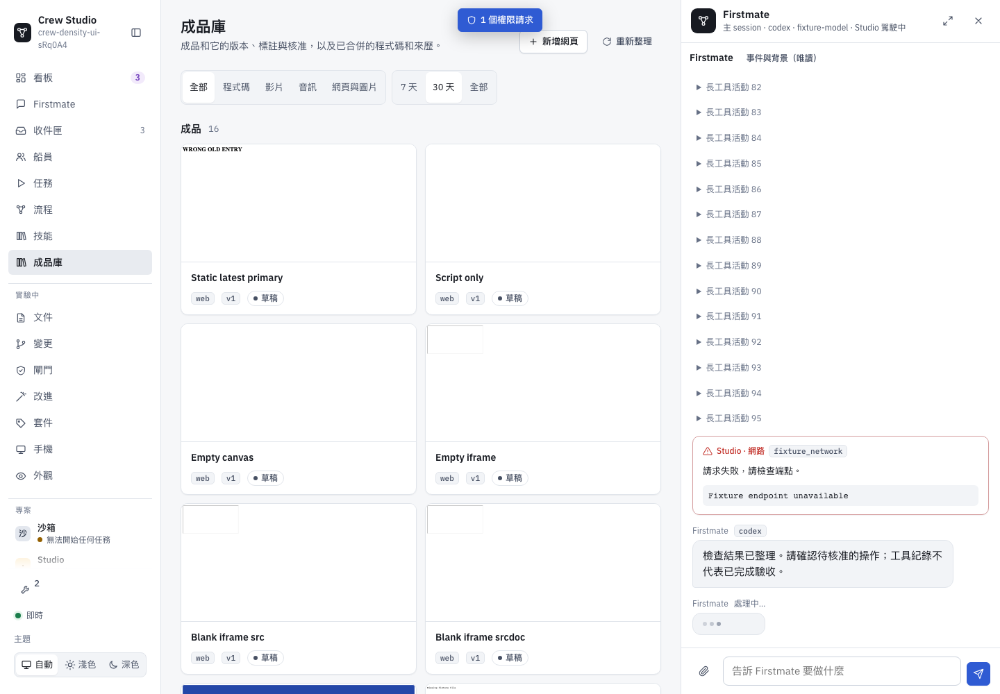
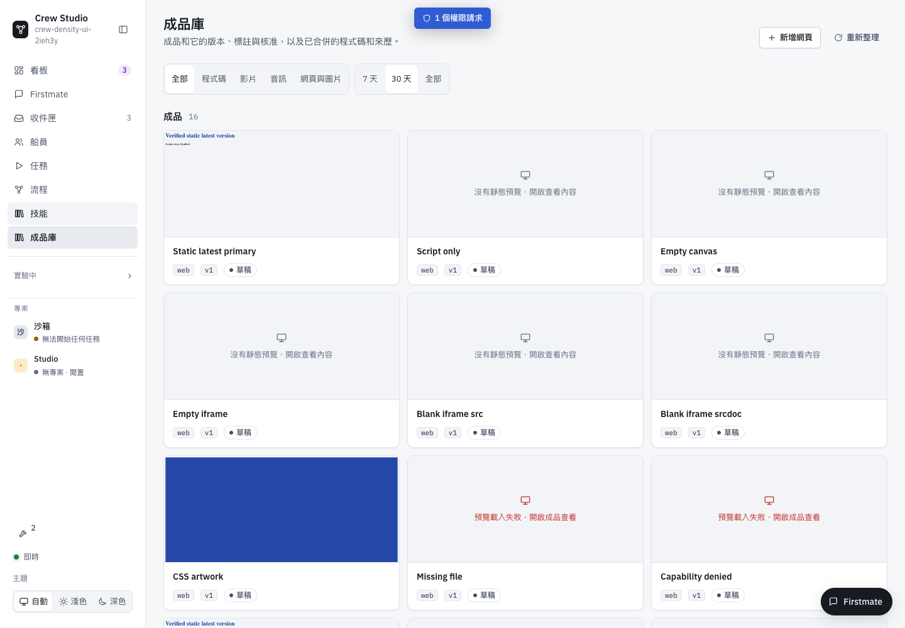
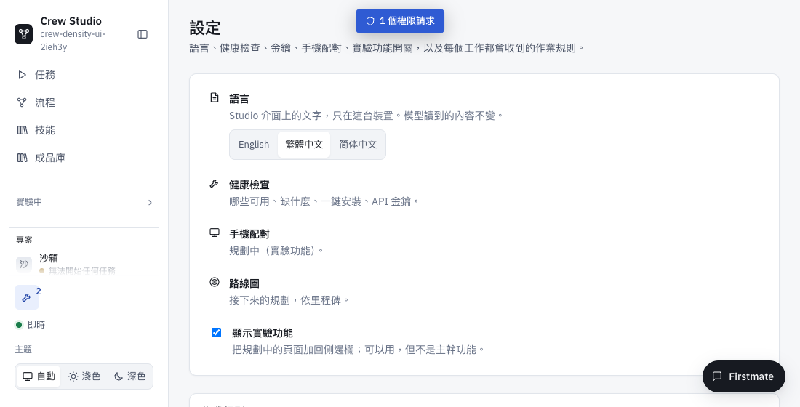
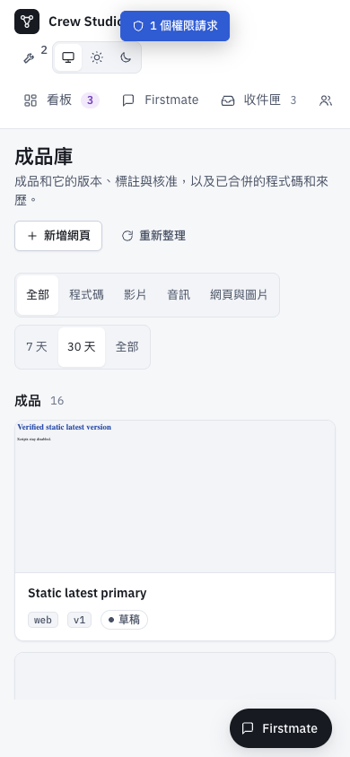

# UI information density — draft evidence

**Not ready for merge.** The root agent's native Chrome acceptance still fails for the automatic delayed HTML thumbnail. Clean installed Chrome and bundled Chromium tests pass; the difference remains unexplained. No merge or deployment was performed.

All images use synthetic conversations, permission prompts and local media fixtures. They contain no customer conversation or real account. Before: original `96b1098e` frontend against the same fixture. After: candidate frontend (`m25.js` SHA256 `748a51f6049aa63f075001e54283429c83c9f39a41063a3fae87aa685af8db70`; `m3.js` SHA256 `da2089b8d5940bddf390af05b5b03355eb05218e0439422990c2c2499f517778`). Browser screenshots are automated test evidence, separate from the root agent's native acceptance.

| Area | Before | Candidate |
| --- | --- | --- |
| Firstmate, desktop |  |  |
| Library, desktop |  |  |

## Implemented behavior

- Consecutive tool activities collapse into one expandable summary; approvals, errors and running state stay outside. Expansion and reading scroll survive repaint. The existing server's 200-record window is retained by the client, rather than truncating to 80 records before grouping. No success state is inferred from a tool-call log.
- Chat starts at 400 pixels, clamps resize to preserve workspace, and remains a full-width phone sheet. Labs starts collapsed, remembers choice, and reveals the current deep-linked parent without enabling the Labs feature flag. Short desktop navigation scrolls independently above Projects and Settings.
- Library cards use the latest primary file and a consistent 170-pixel slot. Missing versions/files, script-only HTML, empty canvas/iframe, refused capability, failed loads and timeouts have named states. HTML thumbnails keep an opaque sandbox with scripts disabled; the HTML analysis uses an inert template. Full managed video detail geometry is preserved.

## Validation and limits

- `node tests/ui-information-density.mjs`: 34 assertions pass in bundled Chromium / installed Chrome (channel `chrome`), including a 96-tool burst, immediate repaint, narrow/short layouts, all preview states, and actual delayed iframe heading. The same new assertions fail against the original frontend (no activity groups).
- Existing suites: Firstmate chat 35/0, backbone navigation 51/0, real media Library UI 122/0. Privacy/OpenCC checks pass in the managed worktree. These are fixtures, not paid-agent or external-service tests.
- Required core is run separately from full CI. The managed worktree under the operator's protected configuration directory cannot run an unchanged staffing fixture CLI inside its sandbox. An exact-byte snapshot under the OS temporary directory, with normal Git metadata and locked dependencies, is used for core verification. Final result is reported in the PR; a green snapshot is not a claim that the original worktree command passed.

## Open native acceptance blocker

The root agent personally verified chat grouping, resize, Labs, short-height reachability, static/image/video previews and named fallbacks. Its native automatic delayed thumbnail issues serial parent HTML requests about every 1600 ms, each HTTP 200, until the 10-second abort. `Sec-Fetch-Dest` is `empty`; the iframe is not created. No repeated capability/static-card requests establish a whole-page repaint cause.

Two one-click controls succeeded: a plain page's native fetch, and a Studio-shell tagged manual fetch, each exactly one request, HTTP 200 and the expected 90-byte body. Automatic requests were untagged, so URL/cache/coalescing/lifecycle differences remain confounded. The application fetch wrappers contain no retry, but the cause is **not established**. Testing stopped at this bounded checkpoint; no speculative retry or longer timeout was added.
